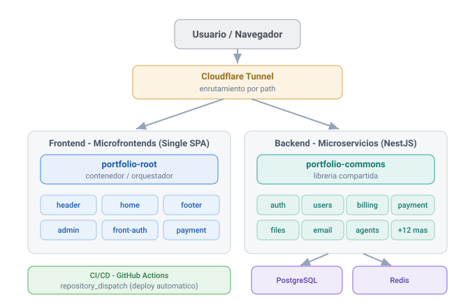

<h1 align="center">Hola, soy Javier Cardona</h1>
<h3 align="center">Desarrollador Full-Stack · Backend & Integración de IA</h3>

  
  
  
  
  

<b>9+ años</b> construyendo software · <b>18 proyectos</b> para marcas en <b>6 países</b> · <b>18 microservicios</b> en producción · <b>5 módulos open source</b>

---

## 🚀 Sobre mí

Desarrollador Full-Stack con **más de 9 años de experiencia** construyendo aplicaciones web
y arquitecturas backend escalables. Diseño sistemas de punta a punta: del microfrontend
al microservicio, del CI/CD al despliegue self-hosted.

- 🔭 Trabajo a diario con **TypeScript, NestJS, React, Angular y Next.js**.
- 🏗️ Me apasiona la **arquitectura de microservicios** y los **microfrontends**.
- 🤖 Construyo **agentes de IA** y automatizaciones con n8n y modelos LLM locales (Ollama).
- 💳 Integro **pagos, facturación electrónica y envíos** para empresas que venden en Latinoamérica.
- 🌐 Todo mi portafolio corre en infraestructura **self-hosted** que administro yo.

## 🛠️ Stack tecnológico

## 📦 Open source

Módulos de NestJS listos para producción, con una sola API para varios proveedores:

| Módulo | Qué resuelve |
|--------|--------------|
| **[nestjs-latam-payments](https://github.com/JavierCardonadev/nestjs-latam-payments)** | Pagos con Wompi, Mercado Pago, PayU, Stripe y PayPal: checkout, webhooks verificados, reembolsos y suscripciones |
| **[nestjs-einvoicing](https://github.com/JavierCardonadev/nestjs-einvoicing)** | Facturación electrónica en Colombia (DIAN), México (SAT), Perú (SUNAT) y Chile (SII) |
| **[nestjs-shipping](https://github.com/JavierCardonadev/nestjs-shipping)** | Tarifas, guías y rastreo con Envia.com y Shippo |
| **[nestjs-whatsapp](https://github.com/JavierCardonadev/nestjs-whatsapp)** | WhatsApp Cloud API: mensajes, plantillas, medios y webhooks |
| **[nestjs-intl-validators](https://github.com/JavierCardonadev/nestjs-intl-validators)** | Validación de documentos de identidad, NIT/RUT/RFC y teléfonos de muchos países |

## ✍️ Blog

- [Cómo integrar Wompi, Mercado Pago, PayU, Stripe y PayPal en NestJS con un solo módulo](https://javiercardona.dev/blog/pagos-latam-nestjs)
- [Facturación electrónica en Colombia, México, Perú y Chile desde NestJS](https://javiercardona.dev/blog/facturacion-electronica-nestjs)
- [Cómo construí un agente de IA que clasifica mis gastos desde el correo](https://javiercardona.dev/blog/agente-ia-finanzas-personales)

## 🏗️ Mi portafolio es una plataforma completa

No es una colección de demos sueltos: es un sistema real, con **~18 microservicios**,
microfrontends independientes y despliegue automatizado.

- **Frontend (Single SPA):** `portfolio-root` orquesta microfrontends independientes
  (header, home, admin, auth, payment…), desplegables por separado.
- **Backend (NestJS):** `portfolio-commons` aporta utilidades transversales a todos los
  servicios (auth, users, billing, payment, files, email, agents, webhooks…).
- **Infra:** Cloudflare Tunnel con enrutamiento por path, PostgreSQL, Redis y Docker,
  con CI/CD automatizado vía `repository_dispatch`.

## 🌐 Organizaciones del portafolio

| Organización | Contenido |
|--------------|-----------|
| 🎨 **[JCDevPortfolio](https://github.com/JCDevPortfolio)** | Microfrontends (Single SPA) — la capa de frontend |
| ⚙️ **[JCDevPortfolio-Back](https://github.com/JCDevPortfolio-Back)** | Microservicios (NestJS) — el backend |

## 📌 Proyectos destacados

- 🤖 **[Agente de IA para finanzas personales](https://javiercardona.dev/blog/agente-ia-finanzas-personales)** —
  clasifica los gastos que llegan por correo con un LLM local (Ollama + n8n + PostgreSQL) y alimenta una app en NestJS y React.
- 🛒 **Plataforma e-commerce autoinstalable** —
  tienda por nicho con licencias firmadas, pagos con Stripe, cotizador de impresión 3D, plugins y webhooks.
- 💳 **Plataforma de microservicios con facturación Stripe** —
  webhooks en producción y manejo centralizado de errores.
- 🎨 **[Design System / Storybook](https://storybook.javiercardona.dev)** —
  sistema de diseño compartido entre los microfrontends.

## 📫 ¿Hablamos?

  🌐 <a href="https://javiercardona.dev/es">javiercardona.dev</a> &nbsp;·&nbsp;
  📄 <a href="https://javiercardona.dev/cv/Javier-Cardona-CV.pdf">CV</a> &nbsp;·&nbsp;
  💼 <a href="https://www.linkedin.com/in/cardona-javier">LinkedIn</a> &nbsp;·&nbsp;
  ✉️ javiercardona.dev@gmail.com

Abierto a oportunidades remotas e híbridas como Desarrollador Full-Stack / Backend.

<!-- profile-readme -->
